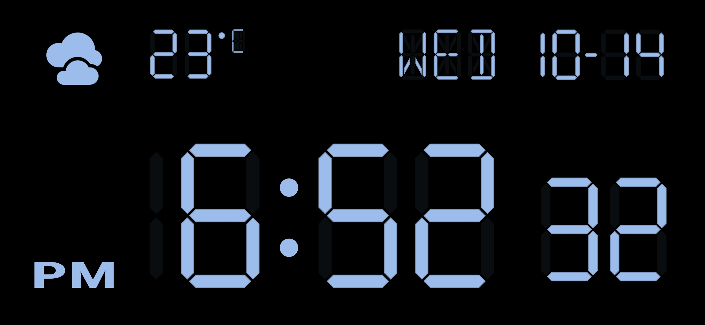
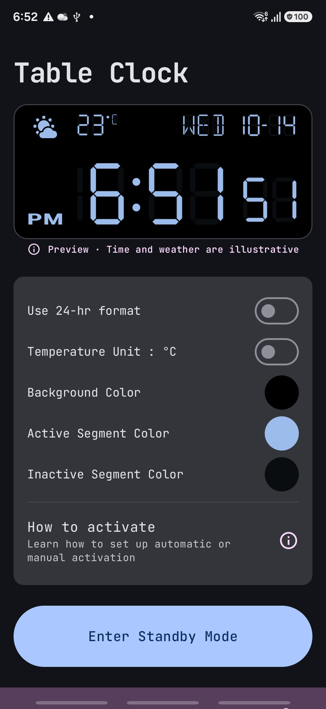
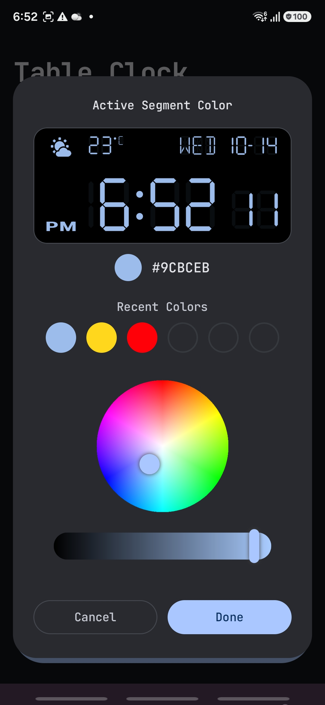

# Table Clock

Table Clock is a modern, retro-styled bedside digital clock application for Android devices. Designed for nightstand docks and screensaver use, it provides a realistic LCD digital clock display with real-time weather integration, extensive color customization, and seamless Android Daydream integration.

Built with modern Android development practices, the application features Jetpack Compose, Material 3 design system, Clean Architecture, and Kotlin Coroutines.

 <p align="center">
  
</p>

<p align="center">
  
  
</p>
---

## Features

- **Retro LCD Clock Display**: Renders 7-segment digital time digits along with 14-segment characters for the day of the week, date, seconds, and AM/PM indicators.
- **Live Weather Integration**: Displays current temperature, weather conditions, and weather icons using the Open-Meteo REST API based on device location.
- **12-Hour / 24-Hour & Temperature Unit Support**: Seamlessly toggle between 12-hour and 24-hour time formats, as well as Celsius (°C) and Fahrenheit (°F) temperature units.
- **Customizable LCD Palette**: Custom HSV color picker for setting independent background, active segment, and inactive segment colors with persistent, category-specific recent color queues.
- **Android System Screen Saver (Daydream)**: Integrates with Android's system `DreamService`, enabling automatic activation when the device is docked or charging.
- **Standby Dock Mode**: Fullscreen landscape display with screen-on flags (`FLAG_KEEP_SCREEN_ON`) and lock-screen overlay support (`setShowWhenLocked`).
- **First-Launch Onboarding Hint**: Subtle onboarding overlay on early standby launches to guide users on how to return to settings via back gestures or buttons.
- **Activation Guidance**: Includes step-by-step instructions for Android screensaver setup, Samsung Modes & Routines automation, and manual launch options.

---

## Tech Stack & Architecture

Table Clock follows **Clean Architecture** principles and the **MVVM** pattern:

- **UI Layer**: Jetpack Compose, Material 3, Custom Canvas Drawing (`LcdClockView`, `ColorWheelView`).
- **Domain Layer**: Immutable domain models (`ClockSettings`), repository contracts, and business logic.
- **Data Layer**: Preferences Data Source wrapping `SharedPreferences`, reactive settings stream via Kotlin `Flow`, and Open-Meteo weather API integration.
- **Concurrency & State**: Kotlin Coroutines, `StateFlow`, `collectAsStateWithLifecycle`.
- **Build System**: Kotlin Gradle DSL, Version Catalogs (`libs.versions.toml`).

---

## Project Structure

```text
com.example.myapplication/
├── data/                         # Data Layer (Data Sources, Repositories)
│   ├── preferences/
│   │   └── PreferencesDataSource.kt
│   └── repository/
│       └── SettingsRepositoryImpl.kt
├── domain/                        # Domain Layer (Models, Repositories)
│   ├── model/
│   │   └── ClockSettings.kt
│   └── repository/
│       └── SettingsRepository.kt
├── ui/                            # UI Layer (Compose Views, ViewModels)
│   ├── components/
│   │   └── StandbyHintOverlay.kt
│   ├── settings/
│   │   ├── SettingsScreen.kt
│   │   ├── SettingsViewModel.kt
│   │   ├── SettingsUiState.kt
│   │   └── components/
│   │       ├── ActivationInstructionsBottomSheet.kt
│   │       ├── ActivationSettingRow.kt
│   │       ├── ColorPickerDialog.kt
│   │       ├── ColorSettingRow.kt
│   │       ├── SettingsSwitchRow.kt
│   │       └── AttributionFooter.kt
│   └── theme/
│       ├── Color.kt
│       ├── Theme.kt
│       └── Type.kt
├── service/
│   └── BedsideDreamService.kt    # Android Daydream Screensaver
├── AppSettings.kt                 # Preference Bridge
├── LcdClockView.kt                # Native Canvas LCD Clock Renderer
├── colorWheelView.kt              # Custom HSV Color Picker
├── StandbyActivity.kt             # Standalone Standby Mode Activity
├── WeatherRepository.kt           # Weather Fetcher
└── MainActivity.kt                # Application Entry Point
```

---

## Getting Started

### Prerequisites

- Android Studio Jellyfish or newer.
- Android SDK (Compile SDK: 37, Minimum SDK: 26 / Android 8.0).
- JDK 11 or higher.

### Building the Project

1. Clone the repository:
   ```bash
   git clone https://github.com/Kart8ik/android-standby-clock.git
   cd android-standby-clock
   ```
2. Open the project in Android Studio.
3. Build the debug APK via Gradle:
   ```bash
   ./gradlew app:assembleDebug
   ```
4. Run unit tests:
   ```bash
   ./gradlew app:testDebugUnitTest
   ```

---

## Usage & Activation Methods

### 1. System Screen Saver (Daydream)
1. Open device **Settings** > **Display** > **Screen Saver**.
2. Select **Table Clock** from the list of screensavers.
3. Choose when to activate (When docked, While charging, or Either).

### 2. Samsung Modes & Routines (Automatic on Charger)
1. Open **Settings** on your Samsung Galaxy device.
2. Navigate to **Modes and Routines**.
3. Create a new Routine:
   - **If**: Charging status is "Charging".
   - **Then**: Open App -> **Table Clock**.

### 3. Manual Standby Mode
Launch the application directly from your home screen or app drawer to enter full-screen landscape standby mode. Swipe back or press the Back button to access settings.

---

## Author

Created by **@Kart8ik**  
GitHub Repository: [https://github.com/Kart8ik/android-standby-clock](https://github.com/Kart8ik/android-standby-clock)

---

## License

This project is licensed under the MIT License. See the [LICENSE](LICENSE) file for details.
